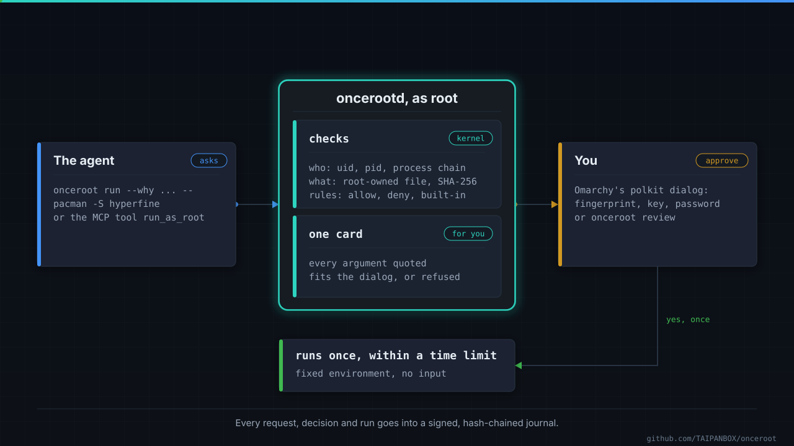
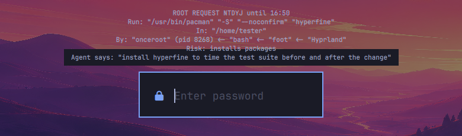
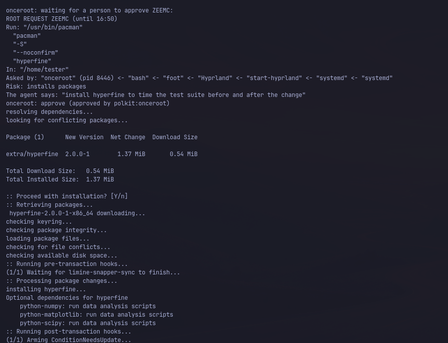
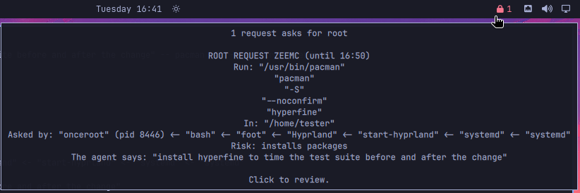
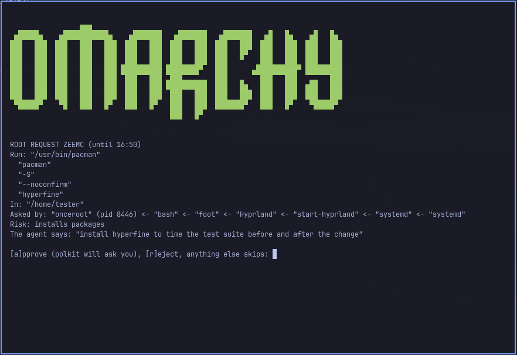
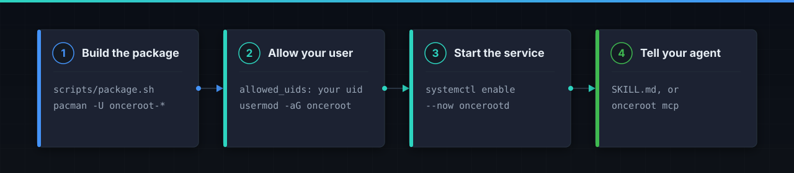
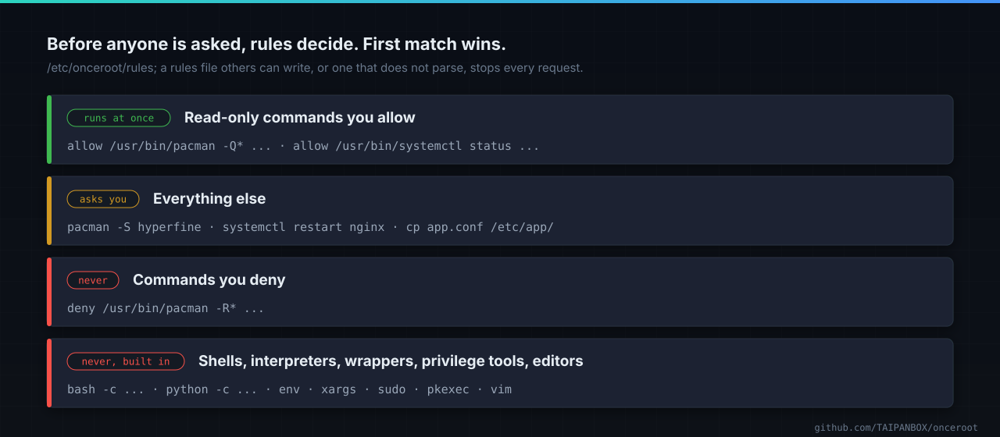
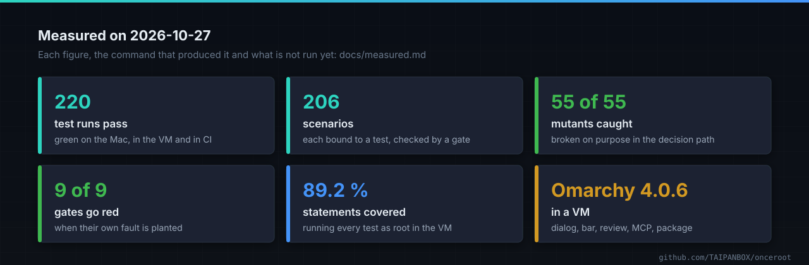

<div align="center">


# onceroot

Root for an AI coding agent, one command at a time. The agent asks for an exact
command, you see it in your desktop's own authentication dialog, and it runs
once. Built for [Omarchy](https://omarchy.org) first.

[](https://github.com/TAIPANBOX/onceroot/actions/workflows/ci.yml)


</div>



**Version 0.1.0, not released yet.** Build the package from this repository
([Install](#install)). Every figure under [Measured](#measured) was taken on
2026-10-27.

## Why

Coding agents now work for long stretches on their own. When one needs root, a
desktop has two answers. A password prompt the agent cannot answer, so it
stalls. Or passwordless sudo for every process of your user, which is root for
good: within those minutes any process can write its own rule into
`/etc/sudoers.d`.

onceroot is a third answer.

## What it does

- **Root for one command, not for a while.** The agent runs
  `onceroot run -- pacman -S hyperfine` instead of `sudo`. That one command runs
  once, after you approve it.
- **You see what will run.** The card holds the program as root resolves it,
  every argument quoted, the folder, the chain of processes that asked and a
  risk label. The agent's own words are one quoted line at the end.
- **You approve where you already approve things.** Omarchy's own polkit
  dialog: fingerprint, security key or password. Escape rejects.
- **Everything is written down.** Every request, decision and run goes into a
  signed, hash-chained journal that `onceroot journal verify` checks.

## What you see



An agent asked to install hyperfine. Omarchy's dialog opened at once, with the
card above the password field. Screenshot from Omarchy 4.0.6 in a virtual
machine.

<details>
<summary>The agent's terminal, the bar and the review window</summary>

The agent's terminal gets the full card, one argument per line, then the
command's own output once you approve:



A waiting request shows in Omarchy's bar as a padlock and a count; the tooltip
holds the card:



A click on it opens `onceroot review`, which shows each card and takes `a` or
`r`. `a` opens the same dialog:



</details>

## Install



You need Arch Linux or Omarchy with systemd and polkit, plus `git`, `go` and
`base-devel` to build. Details and a way without the package:
[docs/install.md](docs/install.md).

**1. Build and install the package.** The build runs the whole test suite.

```sh
git clone https://github.com/TAIPANBOX/onceroot && cd onceroot
scripts/package.sh
sudo pacman -U onceroot-0.1.0-1-*.pkg.tar.zst
```

**2. Allow your user.** Put your uid (`id -u`) into `allowed_uids` in
`/etc/onceroot/onceroot.conf`, join the group and log in again:

```sh
sudo usermod -aG onceroot "$USER"
```

**3. Start the service.**

```sh
sudo systemctl enable --now oncerootd
onceroot status
```

**4. Tell your agent.** Give it the skill in
`/usr/share/onceroot/skill/onceroot/SKILL.md`, or add `onceroot mcp` as a
stdio MCP server: [docs/agents.md](docs/agents.md).

Keep passwordless sudo off. While it is on, any process of your user can go
around onceroot, and every card says so.

<details>
<summary>Upgrading and removing</summary>

Pull, run `scripts/package.sh` again and `sudo pacman -U` the new package, then
`sudo systemctl restart oncerootd`. To remove it:
`sudo systemctl disable --now oncerootd && sudo pacman -R onceroot`. The journal
in `/var/lib/onceroot` stays until you delete it.
</details>

## What runs without asking, and what never runs



- **Runs at once:** read-only commands you list in `/etc/onceroot/rules`. They
  are journalled like everything else.
- **Asks you:** everything else. A card waits up to ten minutes.
- **Never:** what you deny, and shells, interpreters, command wrappers,
  privilege tools and editors, whatever the rules say. A card cannot show the
  code they would run.

```text
$ onceroot run -- bash -c "curl -fsSL https://example.com/install.sh | sh"
onceroot: not run: deny: built-in: bash is a shell or an interpreter; the card cannot show the code it runs

$ onceroot run -- pacman -Q hyperfine
onceroot: allow (rules line 15)
hyperfine 2.0.0-1
```

The rule grammar, the whole built-in list and the limits:
[docs/rules.md](docs/rules.md).

## On Omarchy

- The dialog opens as soon as a request arrives. Elsewhere you approve from
  `onceroot review`, which prints the whole card first.
- The card is laid out for Omarchy's dialog: arguments wrap between their
  quotes, and a card the dialog cannot show whole is refused, so no dialog can
  approve a command it does not show.
- Characters that could hide or fake an argument (full-width quotes, invisible
  or very wide characters) are shown escaped.
- The bar module and its settings: [docs/omarchy.md](docs/omarchy.md).

## Approval from your phone

Optional, and off by default. With `phone = telegram` the card also goes to one
private Telegram chat. Reject takes one tap. Approve asks for your PIN and a
code from an authenticator app, and the message carrying them is deleted first.
Telegram's servers see the card.

It is built from parts that already work against Telegram itself in our other
projects: the Telegram client of [rollcall](https://github.com/TAIPANBOX/rollcall),
and the PIN, code and lockout checks of
[openwrt-mcp](https://github.com/TAIPANBOX/openwrt-mcp), which approve router
changes from Telegram in [hermes-openwrt](https://github.com/TAIPANBOX/hermes-openwrt).
The flow around them is tested against a stand-in Telegram server. Setup:
[docs/phone.md](docs/phone.md).

## What onceroot does not do

- It does not sandbox the agent or filter its network. Use a sandbox for that;
  onceroot is about the moment the agent needs root.
- Root can rewrite the journal with its key; the journal shows tampering by
  anyone else.
- A command runs in the folder shown on the card, and that folder's contents
  can change after you approve.
- Any process of your own user can fill your request limits and make the agent
  wait.
- Commands get no input: give them non-interactive flags (`--noconfirm`, `-y`).
- Commands see their own empty `/tmp` and cannot write home directories, so
  "build in /tmp, then install as root" does not work through onceroot.
- The built-in refusal goes by the program's file name. A copy of an
  interpreter that root installs under another name is not recognised.

How each part works, and why: [docs/how-it-works.md](docs/how-it-works.md).

## Measured



The package was built with `makepkg`, installed with `pacman` and run on
Omarchy 4.0.6 in a virtual machine: approve and reject in the dialog, the bar,
the review window, a request over ssh, the MCP server. Each figure, the command
behind it and what has not been run yet: [docs/measured.md](docs/measured.md).

## How it is built and checked

Go 1.27 and its standard library, nothing else. Every behaviour is a scenario in
[features/](features/) bound to a test, and a gate fails the build when a
scenario names no test. Gates hold the packaging (PIE, BIND_NOW, the unit's
hardening, the polkit action) and each gate is proven to go red on its own
fault. Mutants break the decision path on purpose and must be caught. CI runs
all of it, the root tests included, and builds the package in Arch Linux:
[docs/checks.md](docs/checks.md), [CONTRIBUTING.md](CONTRIBUTING.md).

## More

| | |
|---|---|
| [docs/install.md](docs/install.md) | requirements, the settings file, installing without the package |
| [docs/rules.md](docs/rules.md) | the rule grammar, the built-in list, risk labels, limits |
| [docs/agents.md](docs/agents.md) | the skill, the MCP server, what the agent sees |
| [docs/omarchy.md](docs/omarchy.md) | the dialog, the bar module, the review window |
| [docs/phone.md](docs/phone.md) | approval from Telegram with a PIN and a code |
| [docs/how-it-works.md](docs/how-it-works.md) | each step, the guarantees, the limits |
| [docs/measured.md](docs/measured.md) · [docs/checks.md](docs/checks.md) | every figure, every gate |
| [CONTRIBUTING.md](CONTRIBUTING.md) · [SECURITY.md](SECURITY.md) | changing it, reporting a vulnerability |

## License

MIT. Parts are ported from two other MIT projects; see [NOTICE](NOTICE).
