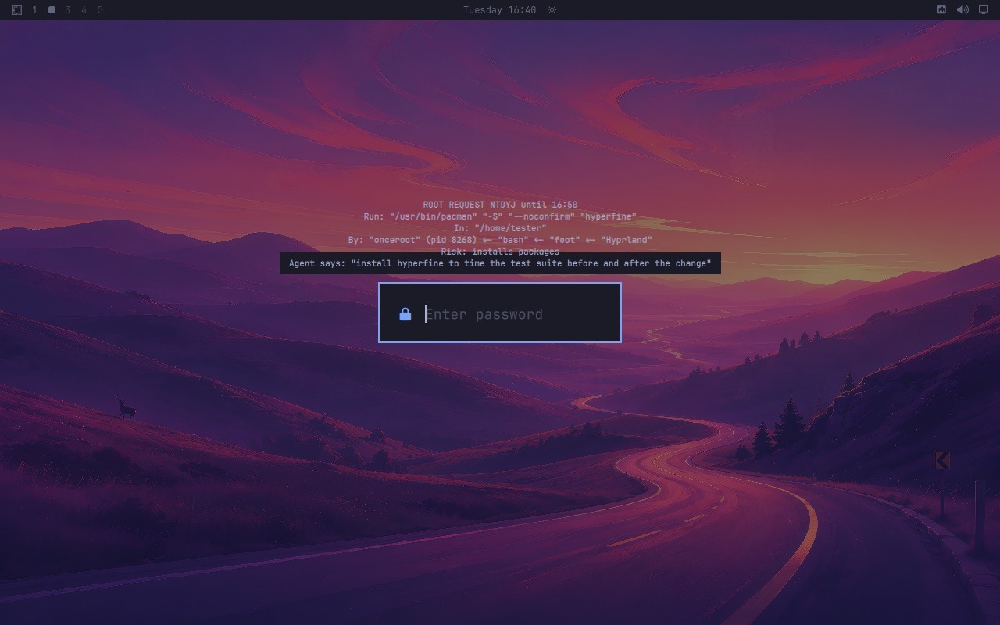

# onceroot on Omarchy



## The dialog

Omarchy's shell has its own polkit agent, and it shows the text it is given.
With `desk_prompt = auto` (the default) the dialog opens as soon as a request
arrives; you approve with a fingerprint, a security key or the password, and
Escape rejects.

The dialog centres each line on a single band just above the password field,
and does not grow with the text. So the card it gets is laid out for it:

- at most twelve lines of 96 characters, the arguments wrapped between their
  quotes, never inside them;
- a card that cannot be shown whole that way is refused, and the agent is asked
  for shorter arguments: no dialog can approve a command it does not show;
- empty lines under the card keep it above the password field;
- characters that could hide or fake an argument (full-width quotes, invisible
  or very wide characters, combining marks) are shown escaped, as `\uff02`.

On other desktops `auto` does not open the dialog on its own; you approve from
`onceroot review`, which prints the whole card first.

A request from a process outside your desktop session (over ssh, say) has no
dialog to open. Its card waits for `onceroot review` or the phone, and the agent
is told so.

## The bar

Add a command module to the bar in `~/.config/omarchy/shell.json`, for example
first in `bar.layout.right`:

```json
{ "id": "onceroot", "type": "command", "exec": "onceroot bar", "interval": 3,
  "tooltip": "onceroot", "onClick": "omarchy-launch-floating-terminal-with-presentation onceroot review" }
```


While nothing waits, the module shows nothing. While requests wait it shows the
padlock Omarchy's own dialog uses and how many, highlighted; the tooltip holds
the cards.

## The review window

A click on the module opens `onceroot review` in Omarchy's floating terminal:


Each card, then `a` (approve: the dialog asks for your fingerprint, key or
password), `r` (reject) or anything else to skip. It says what happened to each
card. A dismissed dialog rejects the card, so nothing can open it again and
again.

## Passwordless sudo

Omarchy can turn on passwordless sudo for a while (`omarchy-sudo-passwordless`).
While it is on, any process of your user can go around onceroot, so
`onceroot status` and every card say so. Keep it off.

## Agents

Omarchy links its own skill into the agents' skill folders (`~/.claude/skills`,
`~/.codex/skills`, `~/.agents/skills`). Put onceroot's skill next to it:
[agents.md](agents.md#the-skill).
