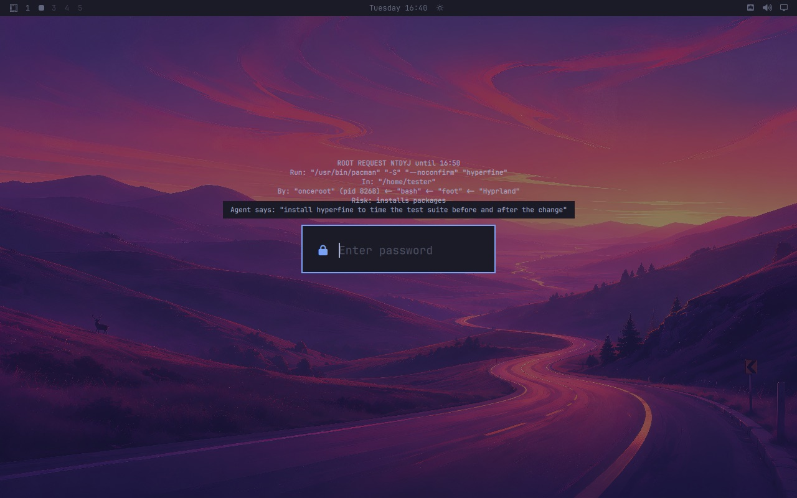
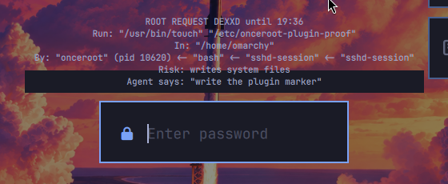
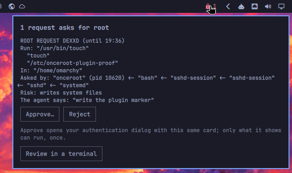
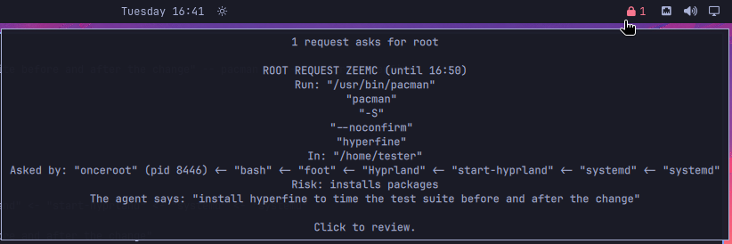
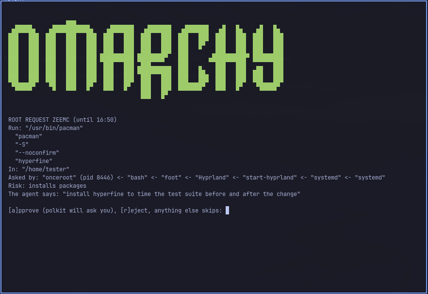

# onceroot on Omarchy



## The dialog

Omarchy's shell has its own polkit agent, and it shows the text it is given.
With `desk_prompt = auto` (the default) the dialog opens as soon as a request
arrives; you approve with a fingerprint, a security key or the password, and
Escape rejects.

The dialog centres each line on a single band just above the password field,
and does not grow with the text. So the card it gets is laid out for it:

- at most twelve lines of 96 characters, the arguments wrapped between their
  quotes, never inside them;
- a card that cannot be shown whole that way is refused, and the agent is asked
  for shorter arguments: no dialog can approve a command it does not show;
- empty lines under the card keep it above the password field;
- characters that could hide or fake an argument (full-width quotes, invisible
  or very wide characters, combining marks) are shown escaped, as `\uff02`.

On Omarchy 4.5 the dialog paints a background behind one line of the message
only; the other lines of the card stand over whatever window is behind it.
Read the card with nothing busy behind the dialog, or read it first in the bar
plugin's card or in `onceroot review`, which show it on a solid background.



On other desktops `auto` does not open the dialog on its own; you approve from
`onceroot review`, which prints the whole card first.

A request from a process outside your desktop session (over ssh, say) has no
dialog to open. Its card waits for `onceroot review` or the phone, and the agent
is told so.

## The bar plugin

On Omarchy 4.5 and later, onceroot comes with a native shell plugin for the
bar, `taipanbox.onceroot`. The package puts it in
`/usr/share/onceroot/omarchy-plugin`; copy it into your plugins and put it on
the bar:

```sh
cp -r /usr/share/onceroot/omarchy-plugin ~/.config/omarchy/plugins/taipanbox.onceroot
omarchy plugin validate ~/.config/omarchy/plugins/taipanbox.onceroot
omarchy bar put taipanbox.onceroot --section right
```



- While nothing waits, it takes no room on the bar and runs nothing: it watches
  oncerootd's journal, which changes on every request, decision and run.
- While requests wait, the padlock and the count show, highlighted. A click
  opens the cards on a solid background, each with Approve and Reject.
- Approve hands the card's id to `onceroot approve`, so Omarchy's own dialog
  opens with the same card and decides. The plugin cannot approve anything by
  itself: Omarchy gives third-party plugins no authentication services, and
  oncerootd takes approval only through polkit.
- A right click opens `onceroot review` in the floating terminal.
- If oncerootd cannot be reached (the service is stopped, or you are not in the
  `onceroot` group yet), the padlock shows a question mark instead of hiding.
- English and Ukrainian; every other language falls back to English.

## The bar without the plugin

On Omarchy before 4.5, or if you prefer it, add a command module to the bar in
`~/.config/omarchy/shell.json`, for example first in `bar.layout.right`:

```json
{ "id": "onceroot", "type": "command", "exec": "onceroot bar", "interval": 3,
  "tooltip": "onceroot", "onClick": "omarchy-launch-floating-terminal-with-presentation onceroot review" }
```



While nothing waits, the module shows nothing. While requests wait it shows the
padlock Omarchy's own dialog uses and how many, highlighted; the tooltip holds
the cards.

## The review window

A click on the module opens `onceroot review` in Omarchy's floating terminal:



Each card, then `a` (approve: the dialog asks for your fingerprint, key or
password), `r` (reject) or anything else to skip. It says what happened to each
card. A dismissed dialog rejects the card, so nothing can open it again and
again.

## Passwordless sudo

Omarchy can turn on passwordless sudo for a while (`omarchy-sudo-passwordless`).
While it is on, any process of your user can go around onceroot, so
`onceroot status` and every card say so. Keep it off.

## Agents

Omarchy links its own skill into the agents' skill folders (`~/.claude/skills`,
`~/.codex/skills`, `~/.agents/skills`). Put onceroot's skill next to it:
[agents.md](agents.md#the-skill).
