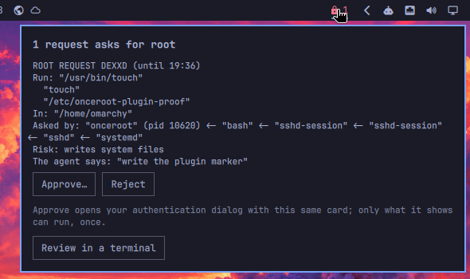

# onceroot for Omarchy's bar

A bar widget for [onceroot](https://github.com/TAIPANBOX/onceroot): root for an
AI coding agent, one approved command at a time.



- While no request waits, it takes no room on the bar and runs nothing: it
  watches oncerootd's journal, which changes on every request, decision and run.
- While requests wait, a padlock and the count show, highlighted. A click opens
  each card on a solid background, with Approve and Reject.
- Approve hands the card's id to `onceroot approve`, so Omarchy's own
  authentication dialog opens with the same card and decides. The widget cannot
  approve anything by itself: Omarchy gives third-party plugins no
  authentication services, and oncerootd takes approval only through polkit.
- A right click opens `onceroot review` in Omarchy's floating terminal.
- If oncerootd cannot be reached, the padlock shows a question mark.
- English and Ukrainian.

## Why it matters on Omarchy

Omarchy is built around coding agents, and it starts them in modes that do not
stop to ask. When such an agent needs root, Omarchy's answer today is
passwordless sudo for a while, and its own manual is clear about what that
means: while it is on, anything running as your user can do anything as root.
A grant can also be extended from the same user without a new confirmation
(discussion #14461). onceroot gives Omarchy a narrower answer that keeps the
agent working:

- **Root for one command, not for a while.** The agent asks for one exact
  command; it runs once if you approve it, and the approval is bound to that
  command, so there is no standing grant to extend or to borrow.
- **You approve where Omarchy already asks you.** The request opens Omarchy's
  own polkit dialog, with your fingerprint, security key or password. Nothing
  new to learn, and nothing in Omarchy to change.
- **What you approve is what you read.** The card names the program as root
  resolves it, every argument, the folder and the chain of processes that
  asked; characters that could fake an argument are escaped, and a card that
  cannot be shown whole is refused rather than shown in part.
- **Shells and interpreters are refused.** `bash -c`, `python -c` and their kind
  never run through onceroot, because no card can show the code they would run.
- **Fewer prompts, so passwordless sudo can stay off.** Read-only commands you
  list run at once, still journalled; prompt fatigue is the usual reason people
  turn passwordless sudo on.
- **A record of what root did.** Every request, decision and run goes into a
  signed, hash-chained journal, so an unattended agent's root work can be
  checked afterwards.
- **Away from the desk.** Optionally, a card can be approved from a phone with a
  PIN and an authenticator code, for agents that keep working while you are out.

This widget is the bar side of it: it shows what waits and lets you open each
card, and leaves the decision to Omarchy's dialog.

## Requirements

- Omarchy 4.5 or later.
- onceroot 0.2.0 or later, installed and running, with your user in the
  `onceroot` group. onceroot runs as root, so install it verified: the package
  from its release workflow, built from the `v0.2.0` tag at commit
  `52dd00e83e81`, with this checksum:

```sh
cd "$(mktemp -d)" &&
gh release download v0.2.0 --repo TAIPANBOX/onceroot -p 'onceroot-0.2.0-1-x86_64.pkg.tar.zst' &&
gh attestation verify onceroot-0.2.0-1-x86_64.pkg.tar.zst --repo TAIPANBOX/onceroot \
  --signer-workflow TAIPANBOX/onceroot/.github/workflows/release.yml \
  --source-ref refs/tags/v0.2.0 --source-digest 52dd00e83e81704c462532beaf1707570aae40e4 \
  --deny-self-hosted-runners &&
echo '8a3823088582065d1d5e6c8017424df0603204e7deab11f1ecc417cabfc73e05  onceroot-0.2.0-1-x86_64.pkg.tar.zst' | sha256sum -c - &&
sudo pacman -U "./onceroot-0.2.0-1-x86_64.pkg.tar.zst"
```
  The commands are one chain: if the download, the attestation or the checksum
  fails, it stops before pacman runs, and a fresh folder means no earlier
  download can stand in for this one.


  Then allow your user and start the service as
  [onceroot's README](https://github.com/TAIPANBOX/onceroot/tree/v0.2.0#install)
  says from step 2. The widget calls only the `onceroot` command; it has no
  other dependency.

## Install

```sh
omarchy plugin add https://github.com/TAIPANBOX/onceroot-omarchy.git --enable
```

The onceroot package carries this widget too, from 0.2.0 on, in
`/usr/share/onceroot/omarchy-plugin`:

```sh
cp -r /usr/share/onceroot/omarchy-plugin ~/.config/omarchy/plugins/taipanbox.onceroot
omarchy bar put taipanbox.onceroot --section right
```

## Remove

```sh
omarchy plugin remove taipanbox.onceroot
```

This takes the widget off the bar and deletes its folder. onceroot itself stays
installed; remove it with `sudo pacman -R onceroot`.

## Source and checks

This repository is published from
[onceroot's omarchy-plugin folder](https://github.com/TAIPANBOX/onceroot/tree/main/omarchy-plugin),
where the widget's tests and gates run in CI: every text is plain text, commands
never go through a shell string, and the id of a card is checked before anything
runs.

## License

MIT, see [LICENSE](LICENSE).
